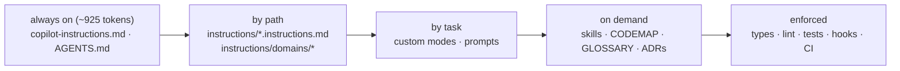

# Homebase

**Lights that follow you — and turn themselves off when you leave.** A small app on a Mac that drives Govee
lights, watches an Android TV and listens to an Android phone, so you stop reaching for light switches.
Built with GitHub Copilot, with the checks and documentation needed to keep changes grounded and verifiable.

React 19 + TypeScript · ASP.NET Core on **.NET 10** · **SQLite** · runs on the Mac · GitHub Copilot (VS Code, CLI, cloud agent, code review)

## What it does

| When… | Homebase… |
|---|---|
| your phone leaves home Wi-Fi | turns every light off |
| you get home after dark | lights the living room, warm |
| the TV comes on after dark | lights the living room for watching |
| the TV goes off late at night | turns the living room off and the bedroom on, dim — your walk to bed |
| the phone has been charging at night for 15 minutes | turns the bedroom off |
| you wake up on a dark morning | brings the bedroom up, bright and cool |

Every rule can be switched off, simulated ("what would happen now, and why?"), and every run keeps a step-by-step
trace — including the ones that were **cancelled** ("Phone stopped charging after 6 of 15 min").

## How it knows

No sensors to buy. Homebase uses what you already have:

| Signal | From | Means |
|---|---|---|
| home / away | the phone's automation app (Tasker, MacroDroid or Automate) calling Homebase | you left or arrived |
| charging, asleep | the same app | going to bed, waking up |
| TV on / off | the TV, over the Android TV remote protocol (paired once with an on-screen code) | you're in the living room |
| dark | sunrise and sunset at your location, worked out on the Mac | lights only come on when they're needed |

Walking into the bedroom in the middle of the day is the one thing it can't see — nothing in the room knows you're there.

## Quick start

```bash
nvm use            # Node ≥ 22.22 (see .nvmrc)
npm ci
npm run dev        # http://localhost:5173 — the whole UI on an in-browser mock, no hardware or .NET needed
npm run verify     # every quality gate, compact output
```

Run it for real (needs the [.NET 10 SDK](https://dot.net)):

```bash
HOMEBASE_LATITUDE=51.51 HOMEBASE_LONGITUDE=-0.13 npm start   # http://localhost:5080 — use your own location
HOMEBASE_LATITUDE=51.51 HOMEBASE_LONGITUDE=-0.13 npm run mac:install   # keep it running, start at login
```

## Set up your home (once)

1. **Lights.** In the Govee Home app, open each light's settings and turn on **LAN Control** (fast, local). Lights without
   it can use Govee's cloud: request an API key (Profile → Settings → Apply for API Key) and set `HOMEBASE_GOVEE_API_KEY`.
   Then **Devices → Find lights**, and put each light in a room.
2. **Location.** Set `HOMEBASE_LATITUDE` and `HOMEBASE_LONGITUDE`, or "dark" simply means 18:00–07:00.
3. **Phone.** Open **Presence** on the Mac (http://localhost:5080/presence) to see the report URL and token, and add
   "HTTP request" actions to your phone's automation app for each event. Install [Tailscale](https://tailscale.com) on the
   phone and the Mac so "left home" can reach the Mac over mobile data.
4. **TV.** On **Presence → Pair the TV**, enter the TV's IP address, then the code it shows.

Settings, the data folder and every environment variable: [docs/ARCHITECTURE.md](docs/ARCHITECTURE.md#configuration).

## Keeping Copilot work honest

| Failure | What we do | Where |
|---|---|---|
| **Invented APIs, files, endpoints** | Generated code map ("not listed = doesn't exist"); one OpenAPI contract; frontend client typed from it, so a made-up endpoint doesn't compile | [`docs/CODEMAP.md`](docs/CODEMAP.md), [`contracts/openapi.yaml`](contracts/openapi.yaml) |
| **Writes the library version it remembers** | Exact pins; ESLint bans `react-router-dom` (gone in v8) | [ADR-0003](docs/adr/0003-pinned-toolchain.md) |
| **Guesses business rules** | Glossary + one rules file per area that loads only when that area is touched | [`docs/GLOSSARY.md`](docs/GLOSSARY.md), [`.github/instructions/domains/`](.github/instructions/domains/) |
| **Claims hardware works** | Drivers are tested against fakes and marked UNVERIFIED until tried on a real light or TV; PRs must say which | [`.github/instructions/domains/devices.instructions.md`](.github/instructions/domains/devices.instructions.md) |
| **"Done!" without proof** | One `verify` command; skipped gates are reported as gaps; CI runs `--strict` on Linux and the backend on macOS | [`scripts/verify.mjs`](scripts/verify.mjs), [`ci.yml`](.github/workflows/ci.yml) |
| **Overconfidence** | Every Copilot response ends with evidence, confidence and what wasn't verified; an independent read-only review mode | [`.github/agents/`](.github/agents/) |
| **Dangerous actions** | Pre-tool-use hook blocks force-push, push to main, `--no-verify`, editing generated files or shipped migrations, reading `.env`, destructive SQL — with tests | [`.github/hooks/`](.github/hooks/), [`scripts/hooks/`](scripts/hooks/) |
| **Stale AI config** | AI-config lint: broken links, dead `applyTo` globs, retired fields, unapproved models, token budgets; weekly strict run | [`scripts/lint-ai-config.mjs`](scripts/lint-ai-config.mjs) |
| **Cost** | ~1.5k-token always-on budget; path-scoped rules; on-demand skills; model tiers; compact tool output; 3-strike rule; pre-built Copilot environment | [`.github/ai-models.json`](.github/ai-models.json), [PLAYBOOK](docs/ai/PLAYBOOK.md#cost-what-actually-moves-the-bill) |

## Working with Copilot

| I want to… | Use | Tier |
|---|---|---|
| Understand code | `/explain` (Codebase Guide) | economy |
| Build a feature | `/plan-feature` → Planner → *edit the plan* → Implementer → Reviewer | premium → standard |
| Fix a bug | `/fix-bug` (test first) | standard |
| Add tests | `/write-tests` | economy |
| Support new hardware | ask in agent mode; the `add-device-driver` skill loads | standard |
| Delegate | Issue form **Copilot task** → assign to Copilot | cloud agent |

Full guide: [docs/ai/WORKFLOWS.md](docs/ai/WORKFLOWS.md).

## The context layers



## Repository map

```
frontend/            React app — src/app (shell), src/domains/{devices,automations,presence}, src/shared/{api,lib,ui}
backend/             .NET 10 — Homebase.Domain/Devices/Application/Data, Homebase.Api(.Host), tests
database/migrations/ SQLite schema + seed (applied at startup, append-only)
contracts/           openapi.yaml — the API contract
scripts/             verify, start, macos-service, codemap, contract check, AI-config lint, guardrail hook
docs/                ARCHITECTURE, GLOSSARY, CODING-STANDARDS, CODEMAP (generated), adr/, ai/
.github/             copilot-instructions, instructions/, agents/, prompts/, skills/, hooks/, workflows/, CODEOWNERS
```

## Read next

- [Coding standards](docs/CODING-STANDARDS.md)
- [How Homebase uses Copilot](docs/ai/PLAYBOOK.md)
- [Staying current: what changed, what to watch](docs/ai/STAYING-CURRENT.md)
- [Architecture](docs/ARCHITECTURE.md) · [Glossary](docs/GLOSSARY.md) · [Decisions](docs/adr/)

## Status

Verified locally (macOS): frontend (44 tests, typecheck, lint, build), backend build with 0 warnings and 122 tests across
domain, drivers, application flows, SQLite and the HTTP API; 18/18 contract routes; guardrail tests; AI-config lint;
a TLS handshake with Homebase's own client certificate. On the real network: discovery found three Govee H6008 bulbs
and read their state over the local API.
**Not verified yet**: switching the bulbs from Homebase, the Govee cloud driver, the Android TV driver, the phone
automation app end to end, `npm run mac:install`, and CI (nothing has been pushed).
