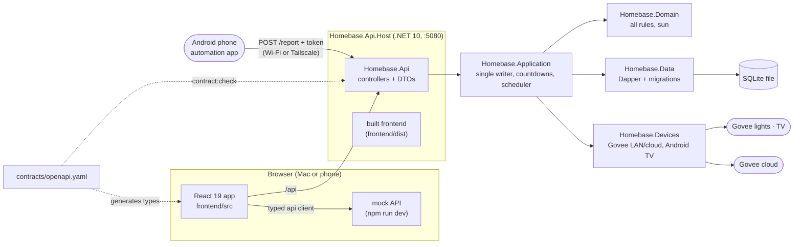

# Architecture

Homebase runs on one Mac at home. It has three areas (Devices, Automations, Presence) on one stack:
React + TypeScript in front, **ASP.NET Core on .NET 10** behind, **SQLite** underneath — one process on port 5080.

## Layers and the rules between them

| Layer | Where | May depend on | Enforced by |
|---|---|---|---|
| App shell | `frontend/src/app` | domains (public API), shared | ESLint |
| Areas | `frontend/src/domains/<area>` | shared; other areas only via `@/domains/<area>` | ESLint `no-restricted-imports` |
| Shared | `frontend/src/shared/{api,lib,ui}` | nothing above it | ESLint |
| API | `backend/src/Homebase.Api` | Application (thin controllers, DTO mapping) | project references |
| Orchestration | `backend/src/Homebase.Application` | Domain, Devices, repository interfaces | project references |
| Rules | `backend/src/Homebase.Domain` | nothing (zero dependencies) | project references |
| Drivers | `backend/src/Homebase.Devices` | Domain | project references |
| Data | `backend/src/Homebase.Data` | Domain | project references |
| Schema | `database/migrations` | — | `SchemaVersions` journal, guardrail hook |

The frontend never decides presence, darkness or automation outcomes; it renders what the API returns.
That keeps one implementation of every rule, in the place that can be unit-tested on any OS.

## How a day works

1. You leave: the phone's automation app sends `{ "home": false }` → the *Leaving home* rule runs the **All off** scene.
2. You come back after dark: `{ "home": true }` → the living room comes on warm.
3. You switch the TV on: the scheduler reads the TV every 15 s → *TV on after dark* lights the living room; *TV off late* switches to **Bedtime**.
4. You plug the phone in by the bed: a 15-minute **countdown** starts; if it is still charging then, the bedroom goes off.

Every run keeps a trace, so the Automations page can say why something happened — or didn't.

## Where each kind of test runs

Every backend test runs on macOS and Linux; CI runs `npm run verify -- --strict` on Linux and the backend tests on macOS.

| Tests | What they use |
|---|---|
| Frontend (Vitest) | the in-browser mock API |
| `Homebase.Domain.Tests` | pure rules, fixed clock |
| `Homebase.Devices.Tests` | fake UDP and HTTP, a local TLS server — no real devices |
| `Homebase.Application.Tests` | in-memory repositories, a fake TV |
| `Homebase.Data.Tests` | a fresh SQLite file per test |
| `Homebase.Api.Tests` | the real ASP.NET Core pipeline in memory |
| Contract checks, codemap, guardrails, AI-config lint | Node only |

## Running it

| You want | Run | You get |
|---|---|---|
| To work on the UI (any OS, Node only) | `npm ci && npm run dev` | http://localhost:5173 on the mock API |
| The real thing, in a terminal | `npm start` | http://localhost:5080 with your lights |
| It always on | `npm run mac:install` (`mac:status`, `mac:uninstall`) | a launchd agent that starts at login; logs in the data folder |
| The real backend behind the dev UI | `npm start`, then `VITE_API_MODE=live npm run dev` | hot reload against real devices |

## Configuration

Environment variables, read at start (`npm run mac:install` bakes in the ones set when you run it):

| Variable | Default | Meaning |
|---|---|---|
| `HOMEBASE_URL` | `http://0.0.0.0:5080` | Where to listen. All interfaces, so the phone can reach it. |
| `HOMEBASE_DATA` | `~/Library/Application Support/Homebase` | SQLite file, report token, logs. |
| `HOMEBASE_TIMEZONE` | the Mac's zone | IANA id for household time. |
| `HOMEBASE_LATITUDE`, `HOMEBASE_LONGITUDE` | unset | Decimal degrees; enables real sunrise/sunset. |
| `HOMEBASE_GOVEE_API_KEY` | unset | Enables the Govee cloud driver and cloud discovery. |
| `HOMEBASE_WEB_ROOT` | `frontend/dist`, found by walking up | The built frontend to serve. |

## Adding things
- A new area → the `scaffold-domain` skill. A new endpoint → `change-api-contract`. New hardware → `add-device-driver`.
- A decision others must follow → `write-adr`.
