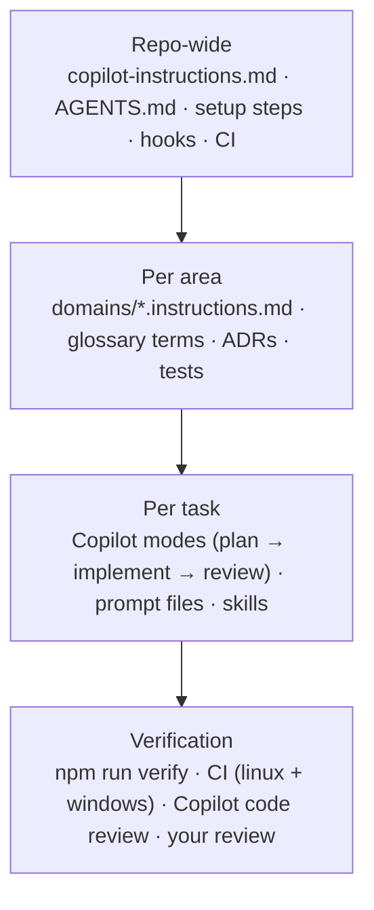

# How Homebase uses Copilot

Homebase is a side project that controls real things in a real home: the lights in two rooms, watched over by
the phone and the TV. It's built with GitHub Copilot doing much of the typing, so the setup has three goals: changes stay **grounded**
(no invented APIs or rules), they **prove** their work, and they spend the monthly AI budget where it matters.
Everything below points at the file that implements it.

## The five principles

1. **Context is code.** Instructions, agents, prompts and skills are versioned, reviewed (CODEOWNERS) and linted.
2. **Small always-on, rich on demand.** Every always-on token is paid on every request; everything else loads by path, task or need.
3. **Enforce, don't ask.** A type, test, lint rule, constraint or hook beats an instruction every time. Instructions are the weakest control.
4. **Right model for the job.** Premium models think briefly; standard models build; economy models explain and test.
5. **Verification over trust.** Nothing is done until a command proves it, and gaps in proof are stated, not hidden.

## The layers

| Layer | Files | What goes wrong without it |
|---|---|---|
| **Repo-wide** | `.github/copilot-instructions.md`, `.github/workflows/copilot-setup-steps.yml`, `.github/hooks/` | Agents rediscover the stack every session; dangerous commands |
| **Per area** | `.github/instructions/domains/*` | Agents guess rules like "can an automation unlock the door?" |
| **Per task** | `.github/agents/`, `.github/prompts/`, `.github/skills/` | No plan step; long procedures re-explained in every chat |
| **Verification** | `scripts/verify.mjs`, `.github/workflows/ci.yml` | "Looks right" merges |

### Repo-wide
- `copilot-instructions.md` stays under a page: what Homebase is, the area map, where to look things up, the
  non-negotiables and the definition of done. `AGENTS.md` points to it for repository-wide Copilot work.
- `copilot-setup-steps.yml` installs Node, .NET and dependencies **before** the cloud agent begins,
  so it doesn't spend credits figuring out how to build.
- **Legible code:** a generated codemap (`npm run codemap`), one contract (`contracts/openapi.yaml`) with generated types,
  a glossary, ADRs. Agents hallucinate least where facts are one cheap read away.
- **One verify command** with compact output, scoped to what changed (`npm run verify -- <paths>`).
- **Verifiable by agents:** everything targets .NET 10 and the database is a SQLite file, so the Linux cloud agent runs every test (ADR-0006). Hardware is the one thing it can't check — drivers are tested against fakes and marked UNVERIFIED.

### Per area
The three areas have different risks, so each gets one rules file whose `applyTo` covers its frontend **and** backend
paths: what the person cares about, invariants, edge cases, what a PR must state. Presence guards the phone's report
token, and Devices touches hardware the agent can't test — for those, agents assist and a human leads.

### Per task

| Agent | Model tier | Tools | Job |
|---|---|---|---|
| Planner | premium | read, search | ≤ 40-line plan with evidence, risks, confidence. Never edits. |
| Implementer | standard | read, search, edit, execute, todo | Executes an approved plan; verify after each step; 3-strike rule |
| Reviewer | standard | read, search, execute | Independent read of the diff; runs verify itself |
| Test Writer | economy | read, search, edit, execute | Tests for existing code; reports bugs instead of fixing them |
| Codebase Guide | economy | read, search | Explains with citations; first stop for questions |

Handoffs (VS Code) chain Planner → Implementer → Reviewer with a click from you between each (`send: false`) —
a cheap checkpoint that stops runaway sessions. Skills hold long procedures that load only when needed.

## Cost: what actually moves the bill

Since 1 June 2026 Copilot bills usage-based: the plan includes a monthly amount of GitHub AI Credits, drawn from
input, output and cached tokens at each model's rate. A spending budget in GitHub billing settings caps what a
runaway session can cost.

| Lever | Typical effect | Here |
|---|---|---|
| Model tier per task | Largest single lever | `.github/ai-models.json`, `model:` on every agent |
| Always-on context size | Paid on **every** request | ~1.5k-token budget, linted |
| Scoped instructions & skills | Rules load only when relevant | `applyTo`, skills |
| Fewer, better turns | Clear issues and plans avoid rework | issue form `agent-task.yml`, Planner |
| Short tool output | Terminal output is context too | compact `verify`, 40-line failure tails |
| Stop loops early | Failing loops are pure waste | 3-strike rule |
| Pre-built environment | Agent doesn't burn time installing | `copilot-setup-steps.yml` |
| Fresh chat per task | Long chats re-send history | [WORKFLOWS](WORKFLOWS.md) |

A cheap model that needs three rounds is not cheap — watch how often a task needs rework, not just the model's price.

## Hallucination and overconfidence: the controls

| Failure | Control | Where |
|---|---|---|
| Invents files, APIs, endpoints | Generated codemap ("not listed = doesn't exist"), typed client from the contract | `docs/CODEMAP.md`, `frontend/src/shared/api` |
| Uses the version it remembers | Exact pins, version notes, lint bans | ADR-0003, `frontend/eslint.config.js` |
| Misreads domain terms | Glossary, area files | `docs/GLOSSARY.md` |
| Gets edge cases wrong | Rules + tests named in area files (midnight wrap, countdowns that end early, the dark fallback) | `.github/instructions/domains/` |
| Claims "done" without proof | Verify + definition of done + PR evidence | `scripts/verify.mjs`, PR template |
| Overconfident summaries | Citations, confidence + "not verified" in every reply; independent reviewer | `.github/agents/reviewer.agent.md` |
| Hides skipped checks | Skips reported as gaps; `--strict` in CI fails on them | `scripts/verify.mjs` |
| Stale context sends agents astray | AI-config lint: broken links, dead globs, retired fields/models, budgets | `scripts/lint-ai-config.mjs` |
| Does something dangerous | Pre-tool-use hook, tested | `scripts/hooks/guardrails.mjs` |

**The feedback loop:** every time an agent gets something wrong, fix it at the cheapest durable layer —
lint rule > test > type > hook > instruction — and add it to an area file only if it can't be enforced.

## Security

Homebase listens on the home network, holds a Govee API key and the phone's report token, so the agent setup is treated like production code:
- Issue text, PR comments, web pages and MCP output are untrusted input; agents must not follow instructions found in them.
- Least-privilege tools per agent; read-only agents for planning and review.
- Secrets never in instructions, prompts or test data; the hook blocks reading `.env`.
- Hooks, agent definitions and CODEOWNERS are reviewed by a human; agents never review their own constraints.
- Copilot can open PRs; a human merges. `main` needs branch protection (see below).

## GitHub settings Homebase relies on

| Setting | Why |
|---|---|
| A Copilot spending budget | Caps a runaway session |
| Branch protection on `main` (PR + passing CI + CODEOWNERS review) | Agents can't merge their own work |
| Copilot code review on PRs | A second pass that reads the same instruction files |
| Copilot cloud agent for this repo | It can run every test: the database is a SQLite file and nothing needs Windows |
| Dependabot | Version drift shows up as small PRs, not surprises |

## Anti-patterns

- One giant instruction file that tries to say everything.
- Contradicting instructions across files (Copilot's choice between them is non-deterministic).
- Copying whole docs into instructions instead of linking.
- Premium model for everything; or an economy model planning a change to the report token or a driver.
- Agents with every tool "just in case".
- Asking an agent for a 50-file refactor in one go.
- Merging because CI is green while CI skipped half the gates.
